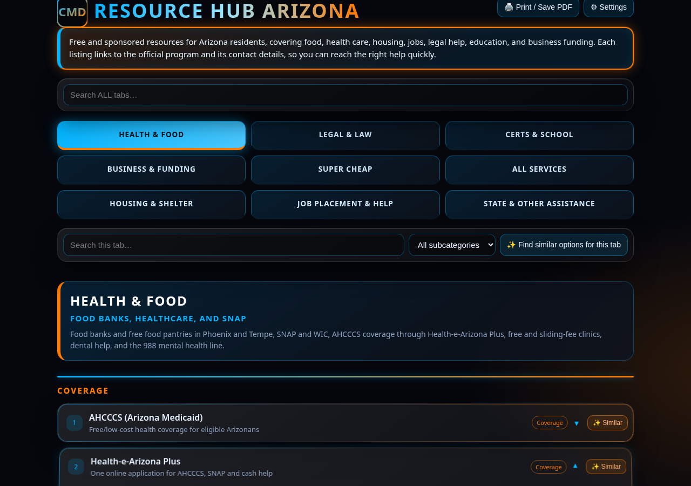

# CMD Resource Hub Arizona

A single-page, standalone directory of free and sponsored resources for Arizona residents, covering food, health care, housing, jobs, legal help, education, and business funding. Each listing links to the official program and its contact details.

It is also an installable web app (PWA): add it to your home screen or desktop and it opens in its own window and keeps working offline once it has loaded one time.

**Live site:** not published yet. Any static HTTPS host works; see [Hosting](#hosting).



## Features
- 9 categories: Health & Food, Legal & Law, Certs & School, Business & Funding, Super Cheap, All Services, Housing & Shelter, Job Placement & Help, State & Other Assistance.
- Works with no JavaScript (CSS-only tabs and native dropdowns), including sandboxed previews such as iPhone in-app viewers.
- With JavaScript: per-tab and global search, subcategory filter, print / save as PDF, and an optional AI "find similar" helper.
- AI uses free no-key providers with automatic fallback; you can add your own free Gemini, Groq, OpenRouter, or Mistral key in Settings. Keys are stored only in your browser's localStorage. No keys are in this repo.
- Dark glass theme in electric blue and orange; SEO metadata and JSON-LD included.
- Installable app with offline support: web app manifest, app icons, and a service worker that keeps the hub available without a connection and offers a one-tap refresh when a new version is published.

## Use
Open `index.html` in any browser, or host the files on any static host (GitHub Pages, Netlify, Vercel, Cloudflare Pages). Serve it gzipped for best mobile performance.

## Install as an app
The install option appears when the hub is opened from an HTTPS address (not from a file on disk).
- **iPhone / iPad (Safari):** tap Share, then **Add to Home Screen**.
- **Android (Chrome):** tap the menu (⋮), then **Install app** or **Add to Home screen**.
- **Desktop (Chrome / Edge):** click the install icon in the address bar, or menu → **Install CMD Resource Hub Arizona**.

After the first visit the hub opens offline. When a new version is published, a small "A new version of the hub is available" bar appears; tap **Refresh** to switch to it.

## Hosting
Upload these files together, keeping the paths: `index.html`, `sw.js`, `offline.html`, `manifest.webmanifest`, `icons/`, `robots.txt`. They work at a domain root or in a subfolder (for example a GitHub Pages project site), because every path is relative. The release zip (`…-site.zip`) contains exactly these files. The service worker only registers over HTTPS.

## Repository layout
| Path | Contents |
|---|---|
| `index.html` | The complete, self-contained site |
| `sw.js`, `offline.html`, `manifest.webmanifest`, `icons/` | App (PWA) files: service worker (generated), offline page, manifest, icons |
| `src/` | Readable sources: `data.json` (listings), `config.py` (text), `css.css`, `core.js`, `app.js`, `providers.json` (AI providers), `pwa.js` (service worker registration and update prompt), `sw.js` (service worker template), `build55.py` (builder) |
| `tests/` | Playwright test scripts (no-JS, JS features, failure fallbacks, links) |
| `docs/` | Full PDF printout, SEO keyword list, data audit log |
| `assets/screenshots/` | Desktop and mobile screenshots |

## Local development
```bash
cd src && python3 build55.py   # writes ../index.html and ../sw.js (new cache version on every change)
cd .. && python3 -m http.server 8000   # then open http://localhost:8000/
```
Edit the readable files in `src/`, rebuild, and reload. The service worker is skipped on plain `http://` and `file://`, so local edits never get stuck in a cache; to try the offline/install behaviour locally, serve the folder over HTTPS (for example with a self-signed certificate).

Tests need Python with Playwright (`pip install playwright && playwright install`) and are run from the repository root:
```bash
python3 tests/t55.py ui        # also: settings, ai, fallback, race, xss, print, a11y
python3 tests/nojs55.py        # no-JavaScript and sandboxed-viewer checks
python3 tests/fail55.py        # script-failure fallbacks
python3 tests/linkcheck.py     # checks every listing and contact link (network)
```
`settings` and `ai` call the free AI providers live, so a provider's rate limit can fail a check.

## Accuracy
Links and contact information were checked as of November 2026. All information came from official organization web pages or an authoritative .gov listing. Programs change; confirm details with the organization before applying.
